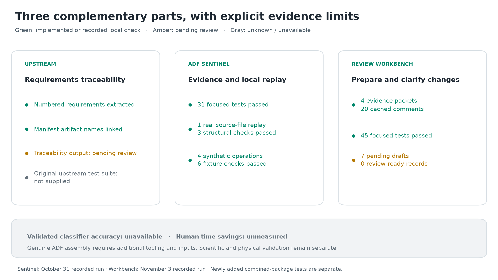
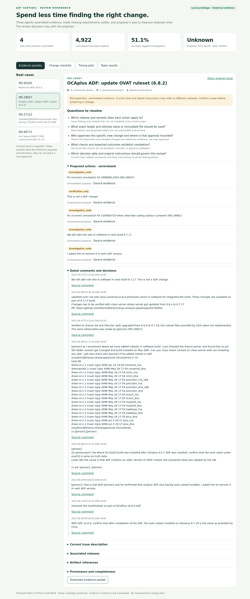
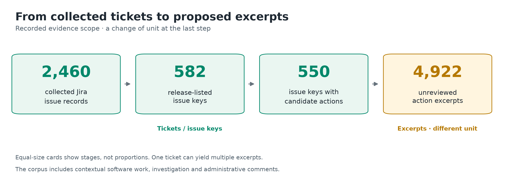
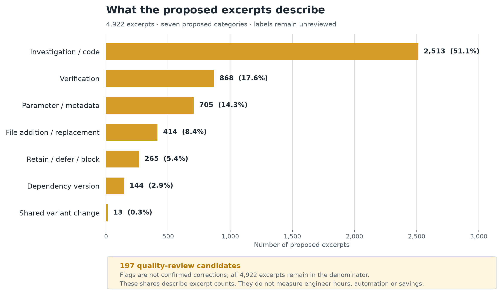
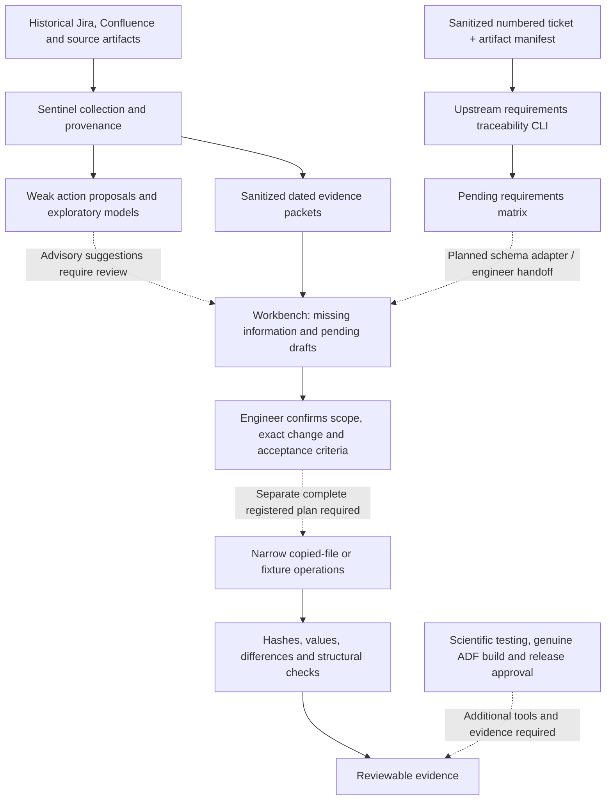

# ADF Sentinel: evidence, requirements, and review

ADF Sentinel helps engineers gather the evidence and exact instructions needed to review an Assay Definition File (ADF) change. This repository combines the requirements traceability component, our historical ADF study, an interactive review workbench, and the IRS-65265 synthetic release-loop demo.

**The strongest demonstrated result is a working review and verification workflow.** It gathers dated sources, makes missing requirements visible, checks narrowly defined file changes, and preserves evidence for review. Full ADF assembly, scientific validation, unseen model accuracy, and engineer time savings remain unestablished.

The historical study ran October 31–November 1, 2026; the review workbench results were recorded November 3. This combined handoff was prepared November 6, 2026. See [source provenance](NOTICE.md) and [package scope](PACKAGE_SCOPE.md).

## Major results



| Component | What works | Evidence and limits |
|---|---|---|
| Requirements traceability | Reads explicitly numbered Markdown requirements, links names from an artifact manifest, and emits a pending matrix | Deterministic parser; artifact-name matching uses substrings. It does not verify file bytes, resolve dependencies, map tests automatically, or approve changes. |
| Historical evidence and exploratory learning | Read-only collection, provenance, proposed action categories, four fitted model baselines, recorded advisory predictions | 79 Confluence pages, 287 release identities across 18 families, and 2,460 Jira issues. Collection is partial; labels remain unreviewed and strict evaluation is blocked. |
| Checked local file operations | Replays a pinned historical source-file change and explicit synthetic fixture operations | One real source file / three checks; four synthetic operations / six checks. Neither result is an installable rebuilt ADF. |
| Review workbench | Four source-linked packets, seven pending change drafts, missing-field checks, label audit, and timing pilot | All 20 cached comments are displayed; 39 of 65 proposed excerpts are shown. No draft is currently complete enough for review or approved for execution. |
| IRS-65265 evidence lab | Synthetic failures, named patch review, explicit retest, and stale-evidence handling | Eight counterfactual scenarios plus a passing control. A requirement revision invalidates three affected assertions while retaining 81 unrelated passes. |

Recorded local verification passed **31 Sentinel tests**, **45 workbench tests**, and **23 evidence-lab tests**, plus their respective browser checks. These counts cover different components and dates; they are software checks rather than scientific or instrument validation. Current handoff checks are recorded in [the package verification report](results/handoff-verification.json).

## Start with the review workbench

Use Python **3.11+**. The requirements CLI, review workbench, and synthetic evidence lab use the Python standard library. No credentials or dependency installation are needed for these quick starts.

From the new repository root:

```bash
python adf-review-workbench/serve.py --port 8877
```

Open [the review workbench](http://127.0.0.1:8877). If running remotely, forward port 8877. It listens only on the local machine and does not contact Jira or GitHub.

1. Choose an issue to inspect its source evidence, dated comments, and open questions.
2. Open **Change checklist** to see missing release scope, targets, values, versions, hashes, and acceptance criteria.
3. Open **Team results** for the label-quality findings.
4. Open **Timing pilot** to download the blank observation sheet.

The [standalone HTML report](adf-review-workbench/workbench.html) also supports offline viewing. Checking edited drafts requires the local server. Draft validation happens in memory; the workbench has no change-execution or release endpoint.



## What the 4,922 count means

**4,922 is the number of proposed action excerpts from 550 Jira issues. It is not a count of Jira tickets or confirmed ADF changes.**



| Selection stage | Count | Interpretation |
|---|---:|---|
| Collected Jira issues | 2,460 | Includes release-related context. |
| Issues explicitly listed against release rows | 582 | Listing is candidate relevance, not confirmed implementation. |
| Listed issues yielding proposed action excerpts | 550 | Thirty-two listed issues yielded no excerpt under the extraction rules. |
| Proposed action excerpts | 4,922 | Weak, unreviewed passages extracted from descriptions, comments, and selected fields. |
| Reviewed action labels | 0 | A strict ADF-development-only dataset has not yet been established. |

Only release-listed issues generated action proposals. Their text still includes software-only instructions, verification, administrative updates, investigations, and retain/defer decisions. **These results are scoped to ADF-release-related candidates.** They do not measure the composition of confirmed ADF development work. [Recorded project facts](results/project-facts.json) retain source hashes and scope notes.

## Work mix and likely time bottleneck



| Proposed bucket | Excerpts | Share |
|---|---:|---:|
| Investigation / code | 2,513 | 51.1% |
| Verification | 868 | 17.6% |
| Parameter / metadata | 705 | 14.3% |
| File addition / replacement | 414 | 8.4% |
| Retain / defer / block | 265 | 5.4% |
| Dependency version | 144 | 2.9% |
| Shared variant change | 13 | 0.3% |

Investigation and clarification are our leading **bottleneck hypothesis**. No human-time observations establish which phase takes the most hours. The four mechanical-change buckets total 25.9% of excerpts; that percentage is not validated automation eligibility or time saved.

The label audit flagged **197 excerpts for review**: 182 possible matches of `hold` inside `threshold`, 13 Jira fix-version administrative comments, and two generic clarification comments. These are review candidates, not confirmed corrections. The original frozen labels were preserved. [Bottleneck report](adf-review-workbench/results/bottlenecks.md)

The next practical reductions are to prepare source evidence automatically, require complete change records, and run approved deterministic checks early. Measure searching, clarification, investigation, editing, review, supervision, rework, and intake separately. Keep waiting and one-time setup separate. [Timing pilot](adf-review-workbench/PILOT.md)

## How the components fit



The components are packaged together with runnable entry points. A requirements matrix is not automatically converted into an executable plan. The upstream traceability and workbench schemas still need a reviewed adapter. Solid arrows describe implemented local relationships; dashed arrows identify manual or additional integration steps.

## Run requirements traceability

The upstream implementation is preserved in [`src/requirements/`](src/requirements/). This example demonstrates its behavior on a sanitized, numbered transcription based on historical material:

```bash
python -m src.requirements.cli examples/ticket.md \
  --release-id IRS-65265-DEMO --version v0.0.3 \
  --artifacts examples/artifacts.json \
  --output results/traceability-demo.json
```

The [saved example matrix](results/traceability-demo.json) contains three pending requirements. Artifact-name matches provide links for review; supplied source URLs and checksum strings are not verified by this parser. Unstructured prose can be omitted, and mapped tests remain unresolved. The example does not approve its historical requirements for a new release.

## Explore the synthetic release loop

Run the evidence lab in a disposable local data directory:

```bash
python irs-65265-review/app.py --data local-data/evidence-lab --port 8765 --reset
```

Open [the evidence lab](http://127.0.0.1:8765). Its generated fixtures demonstrate incorrect settings, dependency/source changes, conditional QC behavior, reviewed patches, explicit retest, and selective invalidation of stale evidence. Its toy bundles are synthetic and non-installable. [Evidence-lab guide](irs-65265-review/README.md)

The historical [real source replay diff](adf-sentinel/runs/sandbox/fb888a2792a7aeea64b5/changes.diff) removes the `--repair-min-freq 30` option from one pinned DNA Tmap actor file. It passed three local checks. It does not establish a new approval, both real variants, or every alignment location.

## Models and historical evidence

The original study fitted majority, TF-IDF logistic regression, TF-IDF linear SVM, and structured-tree models on 4,117 retrospective weak training rows. A rules baseline was implemented separately. There were 418 recorded advisory predictions and zero automatically eligible plans. Reviewed labels, confirmed decision cutoffs, and strict eligible test cases were unavailable, so held-out accuracy and calibrated confidence are unknown. The default advisory model was predeclared, not a validated winner.

This upload copy retains source, aggregate model comparisons, checks, manifests, and sanitized review results. It omits raw transport responses, complete historical text datasets, model binaries that may retain source vocabulary, and the original evidence ZIP. Restoring or rebuilding the full private study requires authorized source inputs and the recorded environment; use a new campaign/output root for materially changed data or models. [Package scope](PACKAGE_SCOPE.md) · [Original run report](adf-sentinel/RUN_REPORT.md)

The original roadmap's 50% improvement and “weeks to days” statements remain goals. No production engineer-hours or lead-time savings have been measured. The upstream baseline also contains a date discrepancy: September 7–October 27 spans 50 elapsed days, while its narrative states 37; the discrepancy is documented in [integration notes](docs/integration/findings.md).

## Repository map

```text
src/requirements/        Pinned upstream extraction and traceability code
adf-review-workbench/   Local review app, sanitized packets, intake and timing pilot
adf-sentinel/           Evidence/model pipeline source and curated recorded results
irs-65265-review/       Synthetic review, patch and retest evidence lab
examples/              Sanitized numbered ticket and artifact-manifest example
assets/figures/         README charts, SVG companions, screenshot and plotting source
docs/upstream/          Original upstream README and planning documents
docs/integration/       Findings, limitations, source provenance and handoff details
results/               Aggregate facts, example matrix and handoff verification
tests/                 New requirements-slice handoff checks
tools/                 Portable checks and package integrity verification
PACKAGE_SCOPE.md        Included files, private-input omissions and reproduction limits
PACKAGE_MANIFEST.json   Checksums for the delivered repository files
```

## Verify the handoff

Run the standard-library checks:

```bash
python tools/run_checks.py
```

Verify packaged file hashes and README assets:

```bash
python tools/verify_release.py
```

Sentinel's optional model/executor tests use the recorded **Python 3.13.13** dependency stack. Use Python 3.13 for this environment; the standard-library quick starts above remain usable with Python 3.11+:

```bash
python3.13 -m venv .venv
.venv/bin/python -m pip install -r adf-sentinel/requirements.lock.txt
.venv/bin/python tools/run_checks.py --include-sentinel
```

The 31 Sentinel checks use synthetic test data and do not require private historical inputs. Plot regeneration additionally needs Matplotlib; reading the README or running the workbench does not. Browser verification needs separately installed Playwright and Chrome. The portable handoff check is `python tools/check_workbench_browser.py --chrome /path/to/chrome`; original component browser scripts are described in their guides.

## Upload to a new repository

For the GitHub website, use the **browser-upload batches** download: six batches
with at most 95 files each. Extract it, upload the **contents of one batch folder**
at the repository root, commit, then repeat for the next batch. Keep the batch
folder names out of your repository paths. [Step-by-step browser instructions](BROWSER_UPLOAD.md)

For a single Git upload from your computer:

The ZIP contains a normal repository directory, not Git history. Extract it, create an empty destination repository, then run these commands inside the extracted directory:

```bash
git init -b main
git add .
git commit -m "Combine ADF Sentinel requirements, evidence and review workbench"
git remote add origin https://github.com/YOUR-ACCOUNT/YOUR-NEW-REPOSITORY.git
git push -u origin main
```

The package retains internal source references and release context. Its `.gitignore` excludes local credentials, environments, private source caches, and model binaries. No open-source license has been inferred from the source repository. [Notice and provenance](NOTICE.md)
